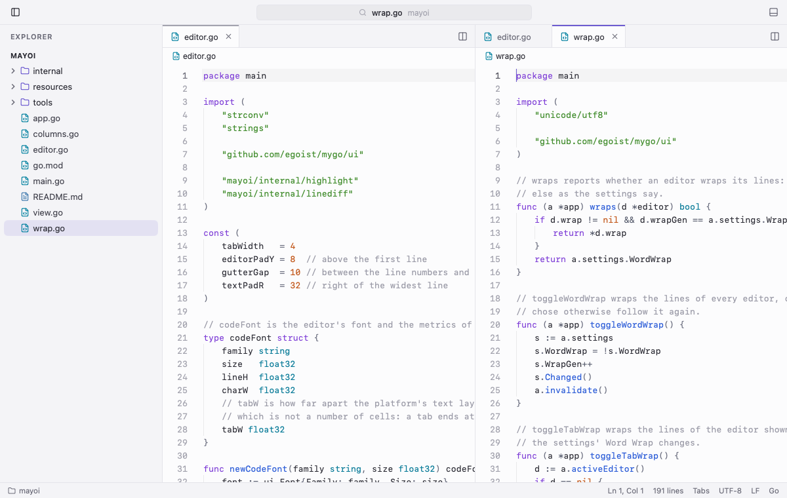

<p align="center">
  
</p>

<h1 align="center">Mayoi</h1>

<p align="center">迷い — a small, fast code editor written in Go. It draws a native UI on the GPU with
<a href="https://github.com/egoist/mygo">MyGo</a>, with no webview and no Electron, and the packaged app is about 18 MB.</p>

<picture>
  <source media="(prefers-color-scheme: dark)" srcset="docs/screenshot-dark.png">
  
</picture>

## Features

- **Editor:** tabs, Chroma syntax highlighting, indent guides, sticky scroll, breadcrumbs and word wrap
- **Smart editing:** auto-indent, auto-closing brackets and quotes, line commands, and per-tab undo
- **Columns:** split the editor side by side and drag tabs between columns
- **Explorer:** a live file tree that follows the disk and dims Git-ignored files
- **Quick open:** fuzzy file search, go to line (`:42`) and go to symbol (`@`)
- **Find and replace:** case, whole-word and regex matching, searched in the background in large files
- **Git:** a source control view to stage, commit, amend, pull and push, every change in one diff, folded
  around the changes, inline or side by side, gutter marks that revert or stage a change, branches and blame
- **Terminal:** Ghostty's emulator (libghostty-vt), in the bottom panel or in a tab
- **Image viewer:** PNG, JPEG, GIF, WebP and BMP, plus a live SVG preview
- **Auto save,** light and dark themes, one window per folder, and a `mayoi` shell command

See [docs/FEATURES.md](docs/FEATURES.md) for the details.

## Requirements

- macOS 13 or later
- Go 1.27 or later

Mayoi also builds for Linux and Windows.

## Getting started

```sh
go run ./cmd/mayoi ~/some/project    # open a folder or a file
go tool mygo build                   # build build/darwin-arm64/Mayoi.app and a .dmg
```

To open folders from a shell, choose **File → Install 'mayoi' Command**, then run `mayoi .` or `mayoi <file>`.

## Development

```sh
scripts/dev.sh                                              # run Mayoi Dev with live reload, with its own settings
go test ./...                                               # headless UI tests
go test -short ./...                                        # skip the tests that start a shell
go test -short -run XXX -bench Frame ./cmd/mayoi            # benchmark an editor frame
SHOTS=$PWD/docs go test -run TestShotReadme ./cmd/mayoi     # redraw the README screenshots
go run ./tools/icongen                                      # redraw resources/icon.png
```

## Releasing

Write the release notes under `## Unreleased` in `CHANGELOG.md` and commit them, then:

```sh
scripts/bump.sh patch    # or minor, major, or a version such as 0.2.0
```

It sets the version in `mygo.json`, renames `## Unreleased` to `## <version>` in `CHANGELOG.md`, commits and tags `v<version>`, and after asking pushes `main` and the tag. The
[Release workflow](.github/workflows/release.yml) then builds macOS (arm64 and Intel, signed and notarized), Windows and
Linux, uploads them with their signed updates, and publishes the release. Installed apps check for it once a day, and
from **Mayoi → Check for Updates…**; the update window shows the changelog section.

The workflow needs these repository secrets:

| Secret | What |
|---|---|
| `MYGO_UPDATER_PRIVATE_KEY` | `mygo-update.key` from `go tool mygo keygen`, whose public key is in `mygo.json` |
| `MACOS_CERTIFICATE` | the Developer ID Application certificate and its key, as a base64 `.p12` |
| `MACOS_CERTIFICATE_PASSWORD` | the password of the `.p12` |
| `APPLE_ID`, `APPLE_TEAM_ID` | the Apple ID of the developer account, and its team ID |
| `APPLE_APP_PASSWORD` | an app-specific password of the Apple ID, from account.apple.com |

Local builds stay signed ad hoc; only the workflow signs with the Developer ID. Windows builds are not signed.

## Keyboard shortcuts

| Shortcut | Action |
|---|---|
| ⌘P / ⇧⌘O / ⌃G | Quick open / go to symbol / go to line |
| ⌘F / ⌥⌘F / ⌘G | Find / replace / next match |
| ⌘S / ⇧⌘S / ⌥⌘S | Save / save as / save all |
| ⌘O / ⌥⌘O | Open folder / open folder in a new window |
| ⌘N / ⌘W / ⌘1…9 / ⌃Tab | New file / close tab / go to tab / next tab |
| ⌘\\ / ⌥⌘→ / ⌥⌘← | Split right / next column / previous column |
| ⌘B / ⌃\` / ⌃⇧\` | Toggle sidebar / toggle terminal panel / new terminal |
| ⌘Z / ⇧⌘Z | Undo / redo |
| Tab / ⇧Tab, ⌘] / ⌘[ | Indent / outdent |
| ⌘/ | Toggle line comment |
| ⌥↑ / ⌥↓, ⇧⌥↑ / ⇧⌥↓ | Move line / copy line |
| ⇧⌘K / ⌘↵ / ⇧⌘↵ | Delete line / insert line below / insert line above |
| ⌘L / ⇧⌘\\ | Select line / go to bracket |
| ⌘= / ⌘- / ⌘0 | Zoom text or image in / out / reset |
| ⇧⌘V | Toggle SVG preview |
| ⌥Z | Toggle word wrap for the current tab |

## Architecture

Mayoi is a single Go program. MyGo provides the windows, the GPU renderer and the text area. Chroma highlights code on a
background goroutine, libghostty-vt runs the terminal, and fsnotify keeps the file tree and the quick-open index current.
Undo history, editing commands and decorations belong to the app rather than the text area, so every column showing a
file shares its text and history.

See [docs/ARCHITECTURE.md](docs/ARCHITECTURE.md) for a tour of the source.

## Performance

These figures come from the tests, run on an M-series Mac:

- A 100,000-line file opens in about 20 ms.
- Scrolling and typing cost under 2 ms per frame, or about 3 ms with find open.
- Highlighting again after a keystroke in a 6,000-line file takes under 1 ms.
- Quick open searches 100,000 paths in about 1.5 ms.

## License

[MIT](LICENSE)
